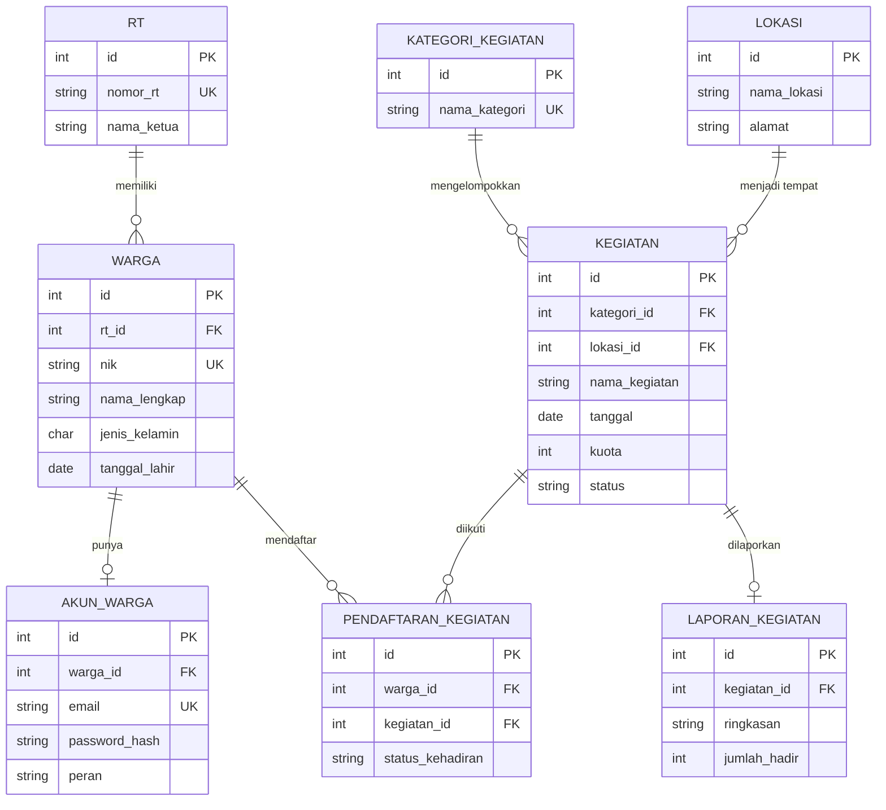
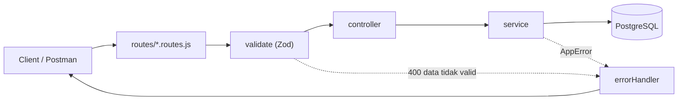

<div align="center">

# Sistem Informasi Kegiatan Desa Sukamaju

REST API untuk mengelola RT, warga, jadwal kegiatan, pendaftaran peserta, dan laporan hasil kegiatan desa.


</div>

## Ringkasan

- **8 tabel** PostgreSQL dengan relasi one to one, one to many, dan many to many.
- **8 resource REST** dengan 5 route CRUD masing-masing: GET semua, GET by ID, POST, PUT, DELETE.
- **Validasi berlapis**: Zod di level request, constraint di level database, dan pesan error PostgreSQL yang sudah diterjemahkan.
- **Arsitektur ringkas**: logika CRUD ditulis sekali di `src/core/`, setiap resource hanya perlu konfigurasi.
- **Postman collection** berisi tes otomatis (status code, JSON schema, isi data, dan pengecekan data sensitif).

## Daftar isi

- [Sistem Informasi Kegiatan Desa Sukamaju](#sistem-informasi-kegiatan-desa-sukamaju)
  - [Ringkasan](#ringkasan)
  - [Daftar isi](#daftar-isi)
  - [Studi kasus](#studi-kasus)
  - [Mulai cepat](#mulai-cepat)
  - [Rancangan database](#rancangan-database)
    - [Relasi](#relasi)
    - [Aturan penghapusan (ON DELETE)](#aturan-penghapusan-on-delete)
    - [Data contoh (`seed.sql`)](#data-contoh-seedsql)
  - [Struktur folder](#struktur-folder)
  - [Arsitektur kode](#arsitektur-kode)
    - [Teknologi](#teknologi)
  - [Instalasi lengkap](#instalasi-lengkap)
  - [Endpoint API](#endpoint-api)
    - [Format response](#format-response)
    - [Contoh body](#contoh-body)
  - [Aturan validasi](#aturan-validasi)
  - [Penanganan error](#penanganan-error)
  - [Pengujian dengan Postman](#pengujian-dengan-postman)
    - [Import dan persiapan](#import-dan-persiapan)
    - [Variable collection](#variable-collection)
    - [Urutan menjalankan](#urutan-menjalankan)
    - [Tes manual untuk resource lain](#tes-manual-untuk-resource-lain)
  - [Pemecahan masalah](#pemecahan-masalah)
  - [Rencana pengembangan](#rencana-pengembangan)
  - [Lisensi](#lisensi)

## Studi kasus

Desa Sukamaju membutuhkan sistem informasi kegiatan desa untuk mengelola jadwal dan peserta kegiatan warga, seperti kerja bakti, siskamling, posyandu, dan perayaan hari besar. Selama ini pengumuman kegiatan hanya disampaikan lewat grup WhatsApp dan pengeras suara masjid. Akibatnya, perangkat desa sulit mengetahui berapa warga yang akan hadir, dan hasil kegiatan tidak terdokumentasi.

Kebutuhan fitur:

1. Pendataan RT dan warga di setiap RT.
2. Data akun untuk setiap warga (satu warga memiliki satu akun).
3. Pengelompokan kegiatan berdasarkan kategori dan lokasi.
4. Penjadwalan kegiatan: tanggal, jam mulai dan selesai, kuota peserta, dan status.
5. Pendaftaran warga ke kegiatan beserta pencatatan kehadirannya.
6. Laporan hasil untuk setiap kegiatan yang sudah selesai.

## Mulai cepat

Prasyarat: Node.js 20 atau lebih baru, dan PostgreSQL.

```bash
git clone https://github.com/Ghifariezra/kegiatan-desa-rest-api.git
cd kegiatan-desa-rest-api
npm install

psql -U postgres -h localhost -p 5432 -c "CREATE DATABASE kegiatan_desa;"
psql -U postgres -h localhost -p 5432 -d kegiatan_desa -f database/schema.sql
psql -U postgres -h localhost -p 5432 -d kegiatan_desa -f database/seed.sql

cp .env.example .env      # Windows PowerShell: Copy-Item .env.example .env
# isi DB_PASSWORD di file .env

npm run dev
```

Server berjalan di `http://localhost:3000`. Detail setiap langkah ada di bagian [Instalasi lengkap](#instalasi-lengkap).

## Rancangan database

| Tabel | Isi |
| --- | --- |
| `rt` | Data Rukun Tetangga |
| `warga` | Data warga desa |
| `akun_warga` | Akun warga |
| `kategori_kegiatan` | Jenis kegiatan (kerja bakti, siskamling, dan lainnya) |
| `lokasi` | Tempat kegiatan |
| `kegiatan` | Jadwal kegiatan desa |
| `pendaftaran_kegiatan` | Warga yang mendaftar ke kegiatan |
| `laporan_kegiatan` | Laporan hasil kegiatan |



### Relasi

| Jenis relasi | Tabel | Penjelasan |
| --- | --- | --- |
| One to one | `warga` - `akun_warga` | Satu warga hanya punya satu akun (`warga_id` bersifat UNIQUE) |
| One to one | `kegiatan` - `laporan_kegiatan` | Satu kegiatan hanya punya satu laporan (`kegiatan_id` bersifat UNIQUE) |
| One to many | `rt` - `warga` | Satu RT memiliki banyak warga |
| One to many | `kategori_kegiatan` - `kegiatan` | Satu kategori memiliki banyak kegiatan |
| One to many | `lokasi` - `kegiatan` | Satu lokasi dipakai banyak kegiatan |
| Many to many | `warga` - `kegiatan` | Lewat tabel `pendaftaran_kegiatan`; pasangan `warga_id` dan `kegiatan_id` bersifat UNIQUE |

### Aturan penghapusan (ON DELETE)

| Menghapus | Efek |
| --- | --- |
| `rt` yang masih punya warga | Ditolak (409) |
| `kategori_kegiatan` atau `lokasi` yang masih dipakai kegiatan | Ditolak (409) |
| `warga` | Akun dan pendaftaran milik warga ikut terhapus |
| `kegiatan` | Pendaftaran dan laporan kegiatan ikut terhapus |

### Data contoh (`seed.sql`)

| Tabel | Jumlah | Catatan |
| --- | --- | --- |
| `rt` | 3 | RT 001 sampai 003 |
| `warga` | 6 | Tersebar di 3 RT |
| `akun_warga` | 3 | Milik warga id 1, 2, dan 4 |
| `kategori_kegiatan` | 4 | Kerja Bakti, Siskamling, Posyandu, Perayaan |
| `lokasi` | 4 | Balai desa, lapangan, pos ronda, saluran air |
| `kegiatan` | 4 | 3 berstatus `dijadwalkan`, 1 `selesai` (id 4) |
| `pendaftaran_kegiatan` | 10 | Banyak ke banyak antara warga dan kegiatan |
| `laporan_kegiatan` | 1 | Untuk kegiatan id 4 |

> [!NOTE]
> Semua nama, NIK, nomor HP, dan email di data contoh adalah fiktif. Nilai `password_hash` pada seed hanya contoh, bukan hash dari kata sandi yang bisa dipakai.

File SQL ada di folder `database`:

| File | Fungsi |
| --- | --- |
| `schema.sql` | Membuat 8 tabel beserta relasi dan constraint |
| `seed.sql` | Mengisi data contoh |
| `reset.sql` | Menghapus semua tabel untuk mengulang dari awal |
| `diagram.dbml` | Versi DBML, bisa di-import ke [dbdiagram.io](https://dbdiagram.io) |

<!-- Tambahkan link dbdiagram publik di sini: [Lihat diagram di dbdiagram.io](URL) -->

## Struktur folder

```
kegiatan-desa-rest-api/
├── database/
│   ├── schema.sql                     # membuat tabel dan relasi
│   ├── seed.sql                       # data contoh
│   ├── reset.sql                      # menghapus semua tabel
│   └── diagram.dbml                   # diagram untuk dbdiagram.io
├── postman/
│   └── API - Desa Sukamaju.postman_collection.json
├── src/
│   ├── index.js                       # titik awal server
│   ├── config/
│   │   ├── env.js                     # memuat file .env
│   │   └── db.js                      # koneksi (pool) ke PostgreSQL
│   ├── core/                          # kode dasar yang dipakai semua resource
│   │   ├── BaseController.js          # handler CRUD generik
│   │   ├── BaseService.js             # query CRUD generik ke database
│   │   ├── createCrudRouter.js        # membuat 5 route CRUD dari sebuah controller
│   │   ├── AppError.js                # kelas error dengan status code
│   │   └── dbError.js                 # menerjemahkan error PostgreSQL ke pesan yang jelas
│   ├── middlewares/
│   │   ├── validate.js                # validasi params dan body dengan Zod
│   │   └── errorHandler.js            # handler 404 dan error global
│   ├── schemas/                       # aturan validasi (Zod) per resource
│   ├── services/                      # akses database dan aturan bisnis per resource
│   ├── controllers/                   # controller per resource
│   └── routes/
│       ├── index.js                   # menggabungkan semua route di bawah /api
│       └── *.routes.js                # route per resource
├── .env.example                       # contoh isi file .env
├── .gitignore
├── package.json
└── package-lock.json
```

Setiap resource memiliki satu file di `schemas`, `services`, `controllers`, dan `routes` dengan nama yang sama, misalnya `kegiatan.js`, `kegiatan.service.js`, `kegiatan.controller.js`, dan `kegiatan.routes.js`.

## Arsitektur kode



| Lapisan | Tugas |
| --- | --- |
| `routes` | Menentukan URL dan method, memasang middleware validasi |
| `middlewares/validate.js` | Memeriksa `:id` dan body dengan schema Zod |
| `controllers` | Menerima request dan mengirim response JSON |
| `services` | Menjalankan query ke PostgreSQL dan aturan bisnis |
| `core/dbError.js` | Menerjemahkan error PostgreSQL (unique, foreign key, check, not null) menjadi pesan yang mudah dibaca |
| `middlewares/errorHandler.js` | Mengubah error menjadi response JSON yang seragam |

Karena kelima route CRUD sama untuk semua tabel, kodenya ditulis sekali di `core/`:

- **`BaseService`** menerima konfigurasi tabel (nama tabel, kolom yang boleh ditulis, query SELECT dengan JOIN, urutan data) lalu menyediakan `findAll`, `findById`, `create`, `update`, dan `delete`. Query memakai parameter (`$1`, `$2`, ...), dan nama kolom diambil dari daftar kolom di service, bukan dari input pengguna.
- **`BaseController`** memanggil service dan membentuk response JSON.
- **`createCrudRouter`** memasang 5 route beserta middleware validasinya.

Resource yang butuh aturan khusus cukup mengoverride method yang diperlukan:

- `akun-warga.service.js`: password dari client di-hash dengan bcrypt sebelum disimpan, dan `password_hash` tidak pernah ikut di response.
- `pendaftaran-kegiatan.service.js`: pendaftaran hanya diterima jika kegiatan berstatus `dijadwalkan` dan kuotanya belum penuh.

Menambah resource baru cukup membuat satu file schema, service, controller, dan route, lalu mendaftarkan route di `src/routes/index.js`.

### Teknologi

| Kebutuhan | Library |
| --- | --- |
| Web framework | Express 5 |
| Database | PostgreSQL (driver `pg`) |
| Validasi input | Zod |
| Hash password | bcryptjs |
| Header keamanan dan CORS | helmet, cors |
| Log request | morgan (nonaktif jika `NODE_ENV=production`) |
| Konfigurasi | dotenv |
| Auto restart saat development | nodemon |

Proyek memakai ES Modules (`import ... from`).

## Instalasi lengkap

**1. Clone repository dan pasang dependensi**

```bash
git clone https://github.com/Ghifariezra/kegiatan-desa-rest-api.git
cd kegiatan-desa-rest-api
npm install
```

**2. Buat database**

```bash
psql -U postgres -h localhost -p 5432 -c "CREATE DATABASE kegiatan_desa;"
```

**3. Buat tabel dan isi data contoh**

```bash
psql -U postgres -h localhost -p 5432 -d kegiatan_desa -f database/schema.sql
psql -U postgres -h localhost -p 5432 -d kegiatan_desa -f database/seed.sql
```

Cek hasilnya dengan `\dt` di dalam psql. Harus muncul 8 tabel.

Untuk mengulang dari awal, jalankan `database/reset.sql`, lalu ulangi `schema.sql` dan `seed.sql`:

```bash
psql -U postgres -h localhost -p 5432 -d kegiatan_desa -f database/reset.sql
```

**4. Atur file `.env`**

Salin `.env.example` menjadi `.env`, lalu sesuaikan isinya:

| Variable | Contoh | Keterangan |
| --- | --- | --- |
| `PORT` | `3000` | Port server |
| `DB_HOST` | `localhost` | Alamat PostgreSQL |
| `DB_PORT` | `5432` | Port PostgreSQL |
| `DB_USER` | `postgres` | User PostgreSQL |
| `DB_PASSWORD` | `password_postgres_kamu` | Password PostgreSQL |
| `DB_NAME` | `kegiatan_desa` | Nama database |

> [!WARNING]
> File `.env` berisi kredensial database dan sudah terdaftar di `.gitignore`. Jangan pernah di-commit.

**5. Jalankan server**

| Perintah | Fungsi |
| --- | --- |
| `npm run dev` | Mode development, restart otomatis saat file berubah (nodemon) |
| `npm start` | Mode biasa (`node src/index.js`) |

Jika berhasil, terminal menampilkan:

```
Server berjalan di http://localhost:3000
Terhubung ke database "kegiatan_desa"
```

Buka `http://localhost:3000` untuk melihat daftar resource yang tersedia.

## Endpoint API

Semua resource memiliki 5 route yang sama.

| Metode | URL | Fungsi | Status berhasil |
| --- | --- | --- | --- |
| GET | `/api/{resource}` | Ambil semua data | 200 |
| GET | `/api/{resource}/:id` | Ambil satu data berdasarkan ID | 200 |
| POST | `/api/{resource}` | Tambah data baru | 201 |
| PUT | `/api/{resource}/:id` | Perbarui data (cukup kirim kolom yang berubah) | 200 |
| DELETE | `/api/{resource}/:id` | Hapus data | 200 |

| Resource | Tabel | Keterangan response |
| --- | --- | --- |
| `rt` | `rt` | Data RT |
| `warga` | `warga` | Menyertakan `nomor_rt` |
| `akun-warga` | `akun_warga` | Menyertakan `nama_lengkap`, tanpa `password_hash` |
| `kategori-kegiatan` | `kategori_kegiatan` | Kategori kegiatan |
| `lokasi` | `lokasi` | Lokasi kegiatan |
| `kegiatan` | `kegiatan` | Menyertakan `nama_kategori` dan `nama_lokasi` |
| `pendaftaran-kegiatan` | `pendaftaran_kegiatan` | Menyertakan `nama_lengkap` dan `nama_kegiatan` |
| `laporan-kegiatan` | `laporan_kegiatan` | Menyertakan `nama_kegiatan` |

### Format response

<details>
<summary><b>Berhasil, GET semua data</b></summary>

```json
{
  "status": "success",
  "message": "Berhasil mengambil semua data akun warga",
  "total": 3,
  "data": [
    {
      "id": 1,
      "warga_id": 1,
      "nama_lengkap": "Agus Santoso",
      "email": "agus.santoso@contoh.id",
      "peran": "admin",
      "created_at": "2026-10-25T15:17:51.361Z"
    }
  ]
}
```

</details>

<details>
<summary><b>Berhasil, GET by ID, POST, PUT, dan DELETE</b></summary>

```json
{
  "status": "success",
  "message": "Akun warga berhasil ditambahkan",
  "data": {
    "id": 4,
    "warga_id": 3,
    "nama_lengkap": "Budi Hartono",
    "email": "budi@sukamaju.id",
    "peran": "warga",
    "created_at": "2026-10-26T01:10:00.000Z"
  }
}
```

Response DELETE berisi data yang baru dihapus.

</details>

<details>
<summary><b>Gagal</b></summary>

```json
{
  "status": "error",
  "message": "Data tidak valid",
  "errors": [
    { "field": "nik", "message": "nik harus 16 digit angka" }
  ]
}
```

</details>

> [!NOTE]
> Kolom bertipe tanggal dikembalikan sebagai teks `YYYY-MM-DD` agar tidak bergeser karena zona waktu.

### Contoh body

<details>
<summary><b>POST /api/warga</b></summary>

```json
{
  "rt_id": 1,
  "nik": "3201012509990001",
  "nama_lengkap": "Naila Putri Fahel",
  "jenis_kelamin": "P",
  "tanggal_lahir": "2003-05-14",
  "no_hp": "081234567890",
  "alamat": "Jl. Melati No. 12, Desa Sukamaju"
}
```

PUT: `{ "no_hp": "089876543210" }`

</details>

<details>
<summary><b>POST /api/akun-warga</b></summary>

```json
{
  "warga_id": 3,
  "email": "naila@sukamaju.id",
  "password": "rahasia123",
  "peran": "warga"
}
```

PUT: `{ "email": "Naila.Putri@sukamaju.id", "peran": "admin" }`. `warga_id` tidak bisa diubah, dan email selalu disimpan dalam huruf kecil.

</details>

<details>
<summary><b>POST /api/kegiatan</b></summary>

```json
{
  "kategori_id": 1,
  "lokasi_id": 1,
  "nama_kegiatan": "Kerja Bakti Persiapan Musim Hujan",
  "deskripsi": "Membersihkan selokan dan memangkas pohon rawan tumbang",
  "tanggal": "2026-11-15",
  "jam_mulai": "07:00",
  "jam_selesai": "10:00",
  "kuota": 30
}
```

PUT: `{ "kuota": 45, "deskripsi": "Membersihkan selokan dan mengecek pintu air" }`

</details>

<details>
<summary><b>POST /api/pendaftaran-kegiatan</b></summary>

```json
{ "warga_id": 3, "kegiatan_id": 1 }
```

PUT: `{ "status_kehadiran": "hadir" }`

</details>

<details>
<summary><b>POST /api/laporan-kegiatan</b></summary>

```json
{
  "kegiatan_id": 1,
  "ringkasan": "Kegiatan berjalan lancar, warga antusias membersihkan lingkungan.",
  "jumlah_hadir": 42
}
```

PUT: `{ "jumlah_hadir": 45 }`. Kegiatan id 4 pada data contoh sudah punya laporan, jadi gunakan kegiatan lain.

</details>

<details>
<summary><b>POST /api/rt, /api/kategori-kegiatan, dan /api/lokasi</b></summary>

```json
{ "nomor_rt": "004", "nama_ketua": "Bapak Slamet Riyadi" }
```

```json
{ "nama_kategori": "Keagamaan", "deskripsi": "Pengajian dan peringatan hari besar" }
```

```json
{ "nama_lokasi": "Masjid Al-Ikhlas", "alamat": "Jl. Kenanga No. 2" }
```

</details>

## Aturan validasi

Kolom bertanda `*` wajib diisi saat POST. Saat PUT, kirim minimal satu kolom.

| Resource | Kolom dan aturan |
| --- | --- |
| `rt` | `nomor_rt`\* 3 digit angka (contoh `001`), unik; `nama_ketua`\* maksimal 100 karakter |
| `warga` | `rt_id`\*; `nik`\* 16 digit, unik; `nama_lengkap`\* maks. 100; `jenis_kelamin`\* `L` atau `P`; `tanggal_lahir`\* `YYYY-MM-DD`, tidak boleh di masa depan; `no_hp` opsional, format `08...` atau `+628...`; `alamat` opsional |
| `akun-warga` | `warga_id`\* (satu warga satu akun, tidak bisa diubah lewat PUT); `email`\* valid dan unik; `password`\* 8 sampai 72 karakter; `peran` opsional `warga` atau `admin` |
| `kategori-kegiatan` | `nama_kategori`\* maks. 50, unik; `deskripsi` opsional |
| `lokasi` | `nama_lokasi`\* maks. 100; `alamat`\* |
| `kegiatan` | `kategori_id`\*; `lokasi_id`\*; `nama_kegiatan`\* maks. 150; `deskripsi` opsional; `tanggal`\* `YYYY-MM-DD`; `jam_mulai`\* dan `jam_selesai`\* format `HH:MM` (selesai harus lebih besar dari mulai); `kuota`\* lebih dari 0; `status` opsional: `dijadwalkan`, `berlangsung`, `selesai`, `dibatalkan` |
| `pendaftaran-kegiatan` | `warga_id`\*; `kegiatan_id`\*; `status_kehadiran` opsional: `terdaftar`, `hadir`, `tidak_hadir`. Lewat PUT hanya `status_kehadiran` yang bisa diubah |
| `laporan-kegiatan` | `kegiatan_id`\* (satu kegiatan satu laporan, tidak bisa diubah lewat PUT); `ringkasan`\*; `jumlah_hadir` opsional, tidak boleh negatif |

**Aturan bisnis pendaftaran:** pendaftaran ditolak (409) jika status kegiatan bukan `dijadwalkan`, kuota sudah penuh, atau warga sudah terdaftar pada kegiatan yang sama.

## Penanganan error

| Kondisi | Status |
| --- | --- |
| Kolom wajib kosong, format salah, atau body kosong | 400 |
| Body bukan JSON yang valid | 400 |
| `:id` bukan angka bulat positif | 400 |
| ID referensi (`rt_id`, `kategori_id`, `lokasi_id`, `warga_id`, `kegiatan_id`) tidak ada di database | 400 |
| Data dengan ID tersebut tidak ditemukan | 404 |
| Route tidak dikenal | 404 |
| Data duplikat (NIK, email, nomor RT, nama kategori, warga sudah punya akun, kegiatan sudah punya laporan) | 409 |
| Warga sudah terdaftar di kegiatan yang sama | 409 |
| Pendaftaran ditutup atau kuota penuh | 409 |
| Menghapus RT, kategori, atau lokasi yang masih dipakai data lain | 409 |
| Kesalahan tak terduga di server | 500 |

## Pengujian dengan Postman

Collection tersedia di `postman/API - Desa Sukamaju.postman_collection.json` dan berisi 5 request untuk resource `akun-warga`. Setiap request sudah memiliki tes otomatis.

### Import dan persiapan

1. Postman: **Import**, lalu pilih file collection di folder `postman`.
2. Pastikan server berjalan dan database baru saja diisi dengan `seed.sql`.
3. Pilih **No Environment**. Variable yang dibutuhkan sudah ada di collection.

> [!IMPORTANT]
> Tes membandingkan hasil dengan data contoh dari `seed.sql` (3 akun, id 1 sampai 3). Jika data sudah berubah, jalankan `reset.sql`, `schema.sql`, dan `seed.sql` lagi sebelum menjalankan collection.

### Variable collection

| Variable | Diisi oleh | Fungsi |
| --- | --- | --- |
| `BASE_URL` | Collection | `http://localhost:3000` |
| `ENDPOINT_API` | Collection | `{{BASE_URL}}/api` |
| `AWID_jsonSchema` | Collection | JSON Schema untuk response satu akun |
| `AWALL_jsonSchema` | Collection | JSON Schema untuk response daftar akun |
| `Account_Data` | Collection | Body request POST |
| `Account_Update` | Collection | Body request PUT |
| `akun_id` | Script POST | ID akun yang sedang dites, dipakai di URL GET by ID, PUT, dan DELETE |
| `akun_terakhir` | Script POST dan PUT | Data akun terbaru, dipakai sebagai pembanding di tes lain |

### Urutan menjalankan

| No | Request | Status | Yang dites |
| --- | --- | --- | --- |
| 1 | `POST` Tambah Akun Warga | 201 | Schema, data sesuai input, `akun_id` tersimpan. Script pre-request memilih warga yang belum punya akun secara otomatis |
| 2 | `GET` Semua Akun Warga | 200 | Schema, `total`, urutan ID, email dan `warga_id` unik, akun baru ada di daftar |
| 3 | `GET` Akun Warga Per ID | 200 | Schema, ID sesuai URL, isi data sesuai |
| 4 | `PUT` Ubah Akun Warga | 200 | Kolom yang dikirim berubah, kolom lain tidak berubah |
| 5 | `DELETE` Hapus Akun Warga | 200 | Data yang dihapus sesuai, `GET` ulang menghasilkan 404, variable dibersihkan |

Semua request juga memastikan `password` dan `password_hash` tidak muncul di response dan waktu respons di bawah 500 ms.

Request bisa dijalankan satu per satu atau lewat **Collection Runner** (1 iterasi). Karena DELETE membersihkan akun yang dibuat POST, seluruh rangkaian bisa diulang tanpa mengubah data contoh.

### Tes manual untuk resource lain

| Skenario | Request | Hasil |
| --- | --- | --- |
| ID tidak ada | `GET /api/warga/9999` | 404 |
| ID bukan angka | `GET /api/warga/abc` | 400 |
| Validasi gagal | `POST /api/warga` dengan `"nik": "123"` | 400 |
| NIK duplikat | `POST /api/warga` dengan NIK yang sama dua kali | 409 |
| Warga sudah punya akun | `POST /api/akun-warga` dengan `"warga_id": 1` | 409 |
| Kegiatan sudah selesai | `POST /api/pendaftaran-kegiatan` dengan `"kegiatan_id": 4` | 409 |
| Sudah terdaftar | `POST /api/pendaftaran-kegiatan` dengan `{ "warga_id": 1, "kegiatan_id": 1 }` | 409 |
| RT masih punya warga | `DELETE /api/rt/1` | 409 |
| Jam tidak berurutan | `POST /api/kegiatan` dengan `jam_selesai` lebih kecil dari `jam_mulai` | 400 |

## Pemecahan masalah

| Gejala | Penyebab dan solusi |
| --- | --- |
| `Gagal terhubung ke database` saat server menyala | Periksa isi `.env` (host, port, user, password, nama database) dan pastikan PostgreSQL berjalan |
| `EADDRINUSE` | Port sudah dipakai. Ubah `PORT` di `.env` atau hentikan proses yang memakai port 3000 |
| `relation "warga" does not exist` | `schema.sql` belum dijalankan pada database `kegiatan_desa` |
| POST akun menghasilkan 409 `warga ini sudah punya akun` | Pilih `warga_id` yang belum punya akun. Pada data contoh, akun dimiliki warga id 1, 2, dan 4 |
| Tes Postman gagal pada data seed | Data sudah berubah dari kondisi awal. Reset database lalu jalankan `seed.sql` lagi |
| Request Postman ke alamat yang salah | Environment lain memiliki variable `BASE_URL`. Pilih **No Environment** |
| Pesan peringatan code page saat memakai `psql` di Windows | Hanya peringatan karakter 8-bit dan tidak memengaruhi data |

## Rencana pengembangan

- Endpoint login dan autentikasi (JWT) berbasis tabel `akun_warga`.
- Pembatasan laju request (rate limiting).
- Pagination dan filter pada endpoint GET semua data.
- Postman collection untuk 7 resource lainnya.

## Lisensi

ISC